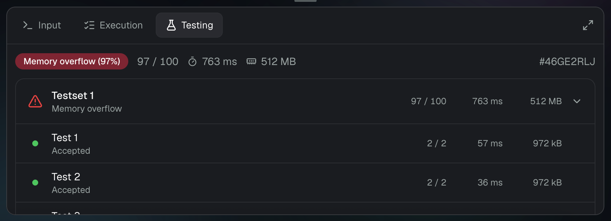
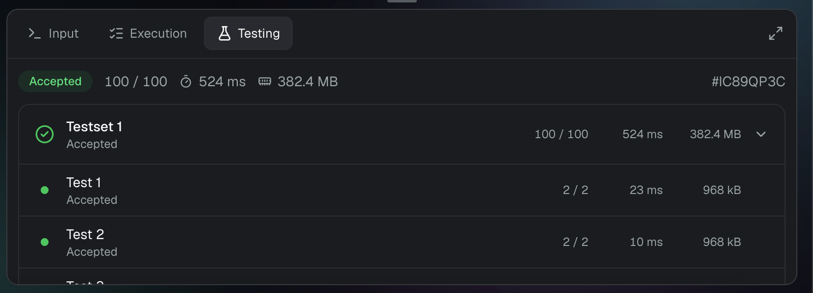
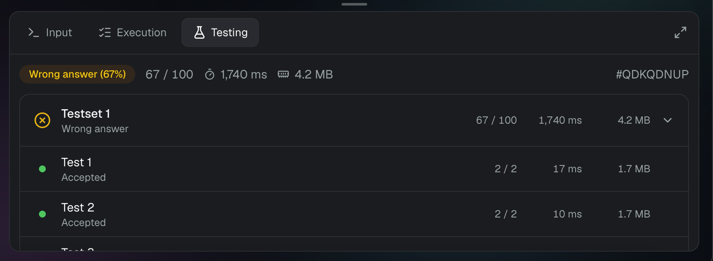
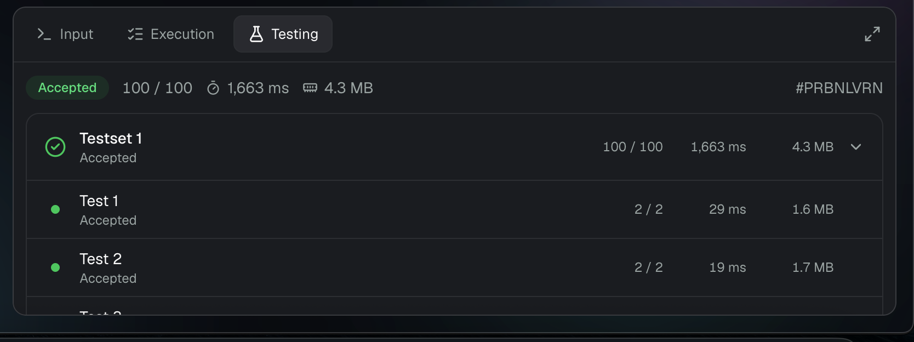

# A5: Functional Programming

This repository contains solution codes for [What is left?](https://eolymp.com/problems/1964) problem in C++ and Haskell.

## C++

The imperative solution is in `main.cpp`. It stores the numbers from 1 to n in a vector. Each round removes even positions, odd positions, or positions divisible by 3. The positions are counted again after every round.

At first, I created a new vector in each round to store the remaining numbers. This version received 97/100 with memory overflow because it needed memory for both vectors at the same time.



Then I changed the code to move the remaining numbers to the front of the same vector and reduce its size. It repeats until one number is left. It uses array processing, not a formula. This version received "Accepted, 100/100" from Eolymp.



Run these commands to test the C++ code from the project root folder:

```bash
mkdir -p build
g++ -std=c++17 -O2 CPP/main.cpp -o build/main
./build/main
```

Enter the number and press Enter. For example, for input 10, the output should be 3.

## Haskell

The functional solution is in `Main.hs`. It starts with a list of numbers from 1 to n. `removeEvens`, `removeOdds`, and `removeThirds` remove numbers by their positions. The function `func` repeats these steps until one number is left. It uses recursion and immutable lists, without loops, changing variables, or a formula.

The version with `removeEvens [x] = []` received 67/100(wrong answer). This line removed the last unpaired element, even though that element should stay.



I changed this case to `removeEvens [x] = [x]` to keep that element. After this fix, the solution received "Accepted, 100/100" from Eolymp. This meets the required score of more than 70.



ghc is needed to compile the Haskell code. Run these commands from the project root folder:

```bash
mkdir -p build
ghc -O2 -outputdir build Haskell/Main.hs -o build/haskell-main
./build/haskell-main
```

Enter the number and press Enter. For example, for input 10, the output should be 3.
